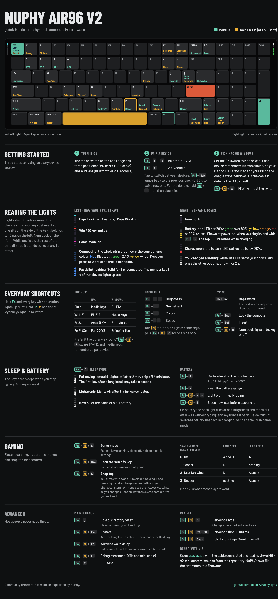
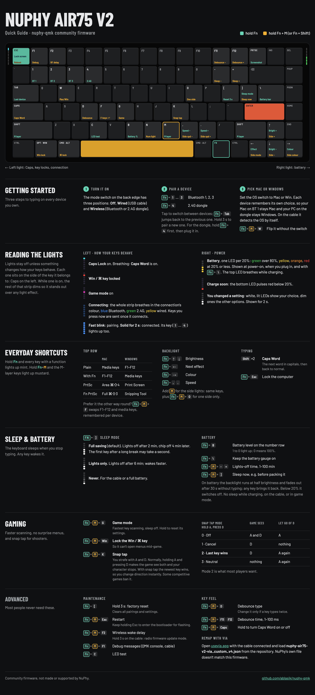
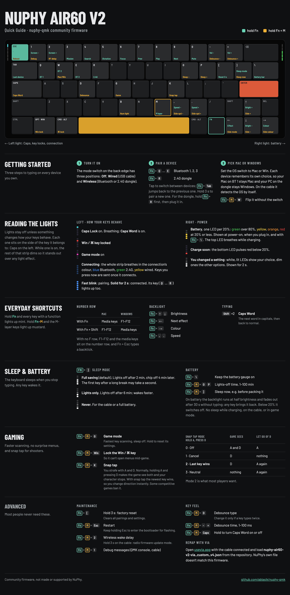

# nuphy-qmk

Community-maintained QMK firmware for NuPhy keyboards.

NuPhy no longer develops the QMK firmware for its V2 boards, and the best community fork ([adi4086](https://github.com/adi4086/qmk_firmware)) is no longer maintained either. This project picks it up: it tracks current upstream QMK, ports NuPhy's own fixes, and adds new features.

| Keyboard   | Status                                  | Board code |
|------------|-----------------------------------------|------------|
| Air96 V2   | ✅ maintained (the author's board)        | [`keyboards/nuphy/air96_v2`](keyboards/nuphy/air96_v2/ansi) |
| Air75 V2   | 🧪 same features, not yet tested on hardware | [`keyboards/nuphy/air75_v2`](keyboards/nuphy/air75_v2/ansi) |
| Air60 V2   | 🧪 same features, not yet tested on hardware | [`keyboards/nuphy/air60_v2`](keyboards/nuphy/air60_v2/ansi) |

All boards live on the `nuphy-keyboards` branch and share the same firmware code. If you own an Air75 V2 or Air60 V2, a test report (even "it works") in the issues helps a lot.

> [!WARNING]
> This is unofficial firmware. Flashing it is at your own risk. The STM32 DFU bootloader can't be overwritten, so you can always go back to stock firmware.

## What's different from stock

On top of NuPhy's firmware (via adi4086's work):

- **Wireless reliability**
  - Far fewer stuck or dropped keys over BT/2.4G.
  - Keystrokes pressed while the keyboard is waking up are buffered, not lost.
  - Fixed random freezes.
- **Battery**
  - Real MCU deep sleep.
  - Variable matrix scan rate when idle.
  - Adjustable sleep timers.
- **Game mode** (`Fn+M+G`): max scan rate (~3500 Hz) and SOCD/snap-tap modes (`Fn+M+K`).
- **Debounce**: algorithm and time adjustable from the keyboard.
- **Caps Word**: double-tap Left Shift.
- **Win lock** and a NumLock/Insert dual key.
- **Battery level** shown on the number row (`Fn+B`).
- **All QMK RGB effects**, plus fewer EEPROM writes.

Added in this repo:

- Rebased on **current upstream QMK** (adi4086's fork was frozen at early 2025).
- **RF packet validation** ported from NuPhy firmware 2.1.x.
- **Readable lights**: holding Fn lights up every key that does something; the side strips show only what changes how your keys behave (Caps, Num, Win lock, game mode) plus battery and connection events.
- **Small daily helpers**:
  - Fn+M+F swaps F1–F12 and media keys on the top row, per device.
  - Fn+Esc locks the computer.
  - Fn+Tab switches back to the previous device.
  - Fn+M+A keeps the computer awake (no idle sleep or screen lock), per device.
  - On the cable the layout follows the detected OS.
  - On battery the backlight runs at half brightness and fades after 30 s idle.
- **Mac/Win per connection**: USB, BT1–3 and 2.4G each remember their own layout. Flip the switch once per device; switching connections restores it.
- **Wireless fixes**:
  - Faster BT reconnect after wake.
  - The first key after deep sleep is no longer swallowed.
  - The keyboard no longer wakes a sleeping Mac.
  - All NKRO keys work over BT/2.4G.
  - No more stuck volume keys.
  - No more lost key releases on link switch.
- **USB fixes**:
  - A keypress wakes a sleeping computer.
  - No deep sleep (and USB detach) while on the cable.
  - Unplugging the charging cable no longer reboots the board.
- **Other fixes and changes**:
  - VIA effect list matches the firmware.
  - Win Fn+PrtSc opens the Snipping Tool.
  - Fn+Shift works like Fn+M.
  - Stock side-light brightness by default.
  - Battery-saver fixes.

## Quick Guide

Every board has a one-page guide to its shortcuts and lights, as an image and a PDF to print.

<details open><summary><b>Air96 V2</b> · <a href="docs/nuphy/air96_v2_quick_guide.pdf">PDF</a></summary>


</details>

<details><summary><b>Air75 V2</b> · <a href="docs/nuphy/air75_v2_quick_guide.pdf">PDF</a></summary>


</details>

<details><summary><b>Air60 V2</b> · <a href="docs/nuphy/air60_v2_quick_guide.pdf">PDF</a></summary>


</details>

The guides are generated from each board's keymap and layout, so they follow the firmware. To edit or rebuild them, see [`docs/nuphy/guide`](docs/nuphy/guide). Every shortcut is also listed in each board's `customizations.md` ([Air96](keyboards/nuphy/air96_v2/ansi/customizations.md), [Air75](keyboards/nuphy/air75_v2/ansi/customizations.md), [Air60](keyboards/nuphy/air60_v2/ansi/customizations.md)).

## Tips

**Raycast.** F4 on the Mac layout sends ⌘ Space, so if Raycast uses ⌘ Space (the usual setup when it replaces Spotlight), F4 opens Raycast. For a Hyper key (⌃⌥⇧⌘), use Raycast's own setting: *Settings → Advanced → Hyper Key*, usually on Caps Lock. That needs no firmware change, but it only works on Macs running Raycast.

**Hyper key and tap/hold keys in VIA.** You don't need to rebuild the firmware for these. In VIA, pick a key, open *Special → Any* and type a QMK keycode:

- `HYPR_T(KC_ESC)`: Esc when tapped, Hyper (Ctrl+Opt+Cmd+Shift) when held. Handy under Caps Lock for Raycast, Alfred or Hammerspoon shortcuts. If VIA doesn't accept it, use the long form `MT(MOD_LCTL|MOD_LSFT|MOD_LALT|MOD_LGUI, KC_ESC)`.
- `MT(MOD_LCTL, KC_ESC)`: Esc when tapped, Ctrl when held.
- `LT(1, KC_SPC)`: Space when tapped, layer 1 when held.

## Requirements

Update the **RF module** and **dongle** to NuPhy's latest firmware (2.1.5) first. Those are closed-source binaries, which you can get from the NuPhy website (Support → Firmware). This repo only replaces the main (QMK) firmware.

## Flashing

1. Download the `.bin` for your board from [Releases](../../releases), or build it yourself (see below). Make sure the file name matches your keyboard.
2. Connect the keyboard over USB.
3. Hold `Fn+M+Esc` for 3 s, until the keys flash white. The keyboard reboots into the bootloader (the lights stay off). Or unplug it and plug it back in while holding `Esc`.
4. Flash the `.bin` from the command line (macOS: `brew install dfu-util`):
   ```sh
   dfu-util -a 0 -d 0483:DF11 -s 0x08000000:leave -D nuphy_air96_v2_ansi_default.bin
   ```
   [QMK Toolbox](https://github.com/qmk/qmk_toolbox) works too, but on Apple Silicon Macs it needs Rosetta (`softwareupdate --install-rosetta`); without it, it prints "Bad CPU type in executable" followed by a misleading "Flash complete", and nothing is flashed.

If a flash fails and the keyboard doesn't start, it can't be bricked: pull off the Caps Lock keycap, hold the small DFU button underneath and plug in the cable. The keyboard comes up in the bootloader; flash it again.

The first boot after switching from stock or adi4086 firmware resets the keyboard settings and the VIA keymap once.

For remapping, load your board's VIA file in [VIA](https://usevia.app) (Settings → Show Design tab → Load): [Air96](keyboards/nuphy/air96_v2/ansi/keymaps/nuphy-air96-v2-via_custom_v4.json), [Air75](keyboards/nuphy/air75_v2/ansi/keymaps/nuphy-air75-v2-via_custom_v4.json), [Air60](keyboards/nuphy/air60_v2/ansi/keymaps/nuphy-air60-v2-via_custom_v4.json). The files are also attached to every release.

## Building

The easiest way is Docker, which needs no local toolchain:

```sh
git clone --recurse-submodules https://github.com/ablasik/nuphy-qmk.git
cd nuphy-qmk
docker run --rm -v "$PWD":/qmk_firmware -w /qmk_firmware ghcr.io/qmk/qmk_cli \
  qmk compile -kb nuphy/air96_v2/ansi -km default   # or air75_v2 / air60_v2
```

Or with the [QMK CLI](https://docs.qmk.fm/newbs_getting_started):

```sh
qmk compile -kb nuphy/air96_v2/ansi -km default
```

## CI and releases

- **Every push and pull request:** GitHub Actions lints and builds all boards and renders the Quick Guides. The `.bin` files and guides are in the run's artifacts, so any PR can be flashed and tried.
- **Every week:** upstream QMK is merged on a `qmk-sync/<date>` branch, all boards are built on it, and a PR is opened with the result (an issue if the merge conflicts).
- **Releases:** a `v*` tag makes a draft release with every board's `.bin`, VIA file and Quick Guide PDF; it's published after a test on real keyboards. What changed in each version is in [`CHANGELOG.md`](CHANGELOG.md); how releases are made is in [`docs/nuphy/RELEASING.md`](docs/nuphy/RELEASING.md).

## Contributing

Issues and PRs are welcome: bug reports, features, and ports to other NuPhy boards.

- Add a line for users to [`CHANGELOG.md`](CHANGELOG.md) under `[Unreleased]` (CI checks it; label the PR `skip-changelog` for changes nobody would notice).
- If you change a keymap or a shortcut, rebuild the Quick Guides ([`docs/nuphy/guide`](docs/nuphy/guide)).
- Report bugs with the [bug form](../../issues/new?template=bug_report.yml): it asks for the board, the firmware version (the release's `.bin` name), the connection and the RF module version, without which wireless and sleep bugs can't be reproduced.
- **Own an Air75 V2 or Air60 V2?** Nobody has tested the firmware on them yet. The pinned [testing issue](../../issues?q=is%3Aissue+is%3Aopen+label%3Atesting) has a short checklist.
- The board code lives in [`keyboards/nuphy/`](keyboards/nuphy). Everything else is upstream QMK, so please don't edit core QMK files.

### Staying on current QMK

This repo keeps full QMK history, and every upstream release is merged in:

```sh
git remote add qmk https://github.com/qmk/qmk_firmware.git   # once
git fetch qmk master
git merge qmk/master
git submodule update --init --recursive
```

When upstream changes an API (as happened with `eeconfig_*_datablock` and `debounce()`), fix the board code in a separate commit right after the merge.

## Credits

- [NuPhy](https://nuphy.com) for the original open-source firmware.
- [adi4086](https://github.com/adi4086/qmk_firmware) for most of the enhancements.
- [jincao1](https://github.com/jincao1) for the reporting and freeze fixes adi4086 built on.
- [QMK](https://github.com/qmk/qmk_firmware) and all its contributors.

## License

GPL-2.0-or-later, same as QMK. See [LICENSE](LICENSE).
